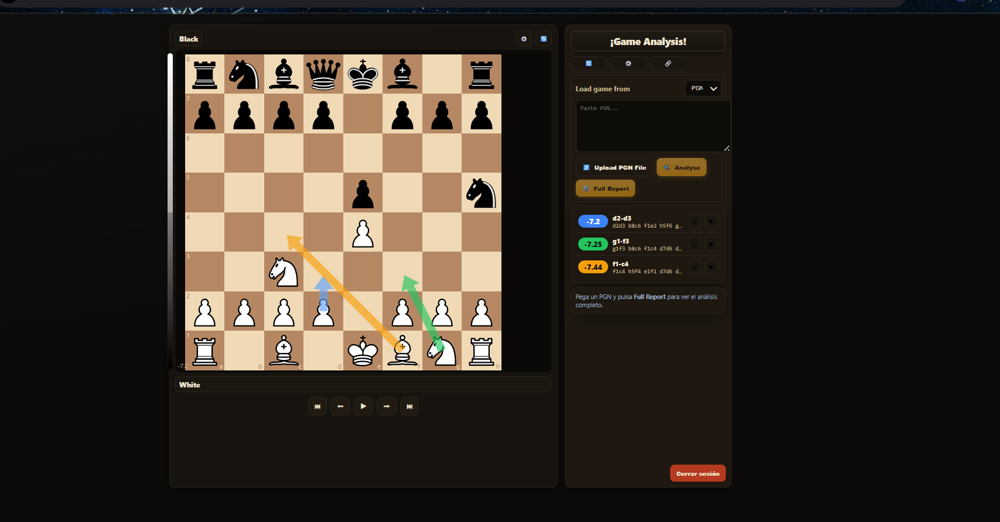
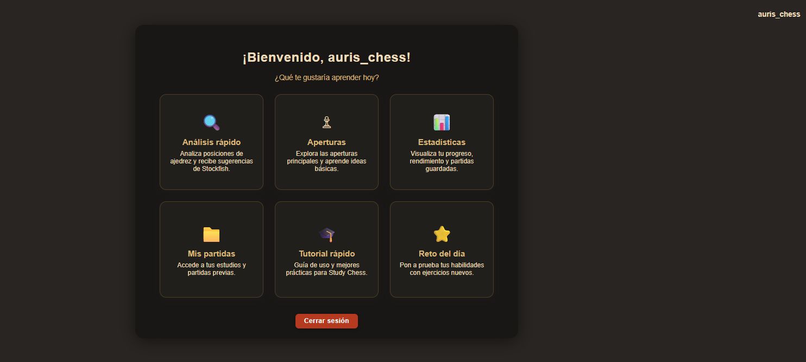



# Rafael Ancalipe

### Full Stack Developer · Software Engineer

Ingeniero Informático enfocado en el desarrollo de aplicaciones web, integración de APIs y soluciones de software.

Con conocimientos en inteligencia artificial y en proceso de profundizar en su integración con aplicaciones Full Stack.

**Santiago, Chile · Inglés B2**

---

## Tech Stack

### Frontend

  

### Backend & Languages

  

### Databases & Cloud

  

  
  

### Developer Tools

  

  
  

<b>Additional Technologies & Tools</b>

 

**Automation & Data**

  
  
  
  
  

**Monitoring & Observability**

  
  
  

---

## Featured Projects

### Chess Study

**Plataforma Full Stack para análisis y aprendizaje de ajedrez**

Aplicación web desarrollada con React y Firebase que integra Stockfish para analizar partidas y proporcionar retroalimentación sobre movimientos.

  

  

  
  
  
  

**Funcionalidades:** análisis con Stockfish, importación PGN, autenticación con Google y correo electrónico, biblioteca de estudios y persistencia en Firestore.

  

---

### Other Projects

<table>
<tr>
<td width="50%" valign="top">

### Rentify

**PropTech · En desarrollo**

Plataforma web orientada a la administración de arriendos residenciales.

Diseñada para propietarios, administradores, arrendatarios y corredores de propiedades.

**Enfoque:** desarrollo Full Stack, gestión de usuarios y administración de información inmobiliaria.

**Repositorio:** Próximamente.

</td>
<td width="50%" valign="top">

### Conde-access

**Proyecto de software · Pendiente de publicación**

Proyecto que será incorporado al portafolio junto con su documentación técnica.

Se publicarán sus funcionalidades, arquitectura y tecnologías utilizadas una vez que estén disponibles.

**Repositorio:** Próximamente.

</td>
</tr>
</table>

---

## Artificial Intelligence

**Learning & Professional Development**

Cuento con conocimientos en inteligencia artificial generativa y utilizo herramientas de IA como apoyo en actividades de desarrollo de software, investigación técnica y resolución de problemas.

Actualmente estoy profundizando en:

- Integración de modelos y APIs de inteligencia artificial.
- Desarrollo de funcionalidades asistidas por IA.
- Automatización inteligente.
- Fundamentos de Machine Learning.

Mi objetivo es complementar mi perfil Full Stack con una especialización progresiva en inteligencia artificial aplicada al desarrollo de software.

  
  
  

---

## Contact

**Open to Full Stack Development & Software Engineering opportunities**

Santiago, Chile · English B2

[LinkedIn](https://www.linkedin.com/in/rafaelancalipe/) · [Email](mailto:Raphaelauris@gmail.com) · [GitHub](https://github.com/AurisKonig)

